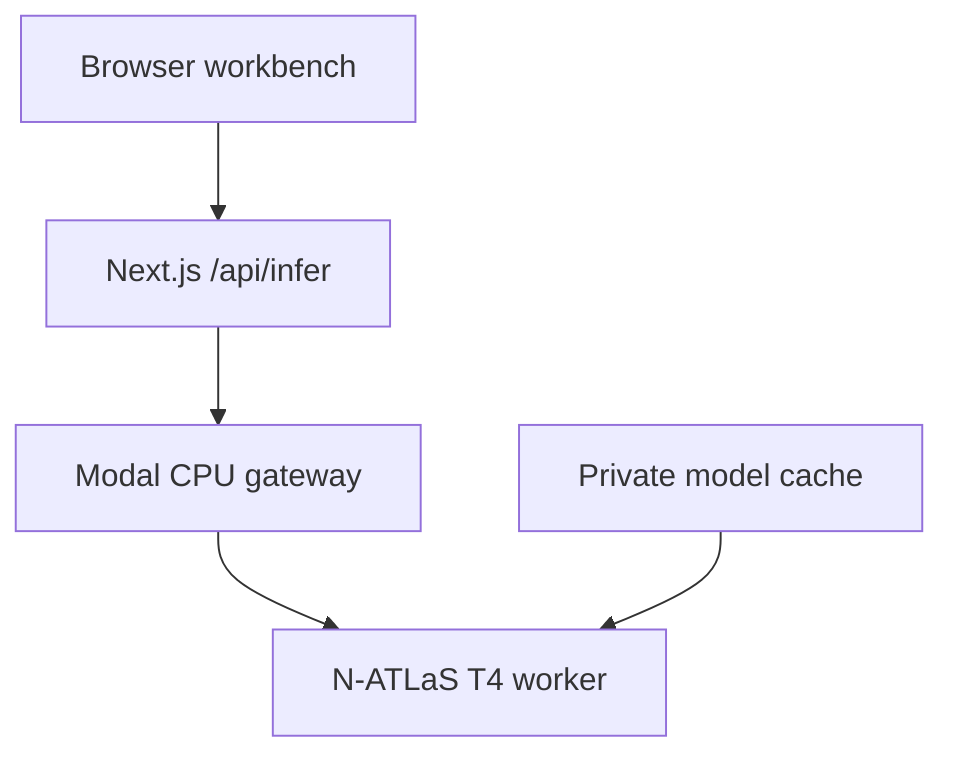

# Architecture

The browser sends the prompt, language instruction, endpoint configuration, and endpoint access key to the application server. The server validates the request and upstream URL, constructs the selected protocol's payload, forwards it, and returns a normalized response. The browser keeps results and reviewer notes until the tab is reloaded.

The Modal gateway checks `ATLAS_API_KEY` before invoking the GPU. `HF_TOKEN` is injected from Modal Secrets for gated model downloads. The GPU worker uses the pinned revision `e294476928aca9030e924ca27bb8e085e8581273`, 4-bit NF4 with double quantization, and float16 computation. The configured input limit is 2,048 tokens and output limit is 512 new tokens. The model cache is a private Modal Volume.

## Runtime differences

The owner-tested hosted website uses Sites/Vinext on a Cloudflare Worker with owner-private access. The GitHub package uses Next.js on Node, the same UI and adapter, and a small route environment-binding change. The private hosted access policy is not exported. This package requires its own authentication before public hosting. It has not been deployed to another production host during preparation.

## Timing and provenance

Browser latency includes app proxy and network time, and may include model startup. The standalone Modal warm-up report also includes GPU generation time when supplied by the worker. These timings are not interchangeable. `tokens` in the web export uses upstream **total tokens** (prompt plus completion), not completion tokens alone.

A response's `reported_model` is supplied by the endpoint. It is not cryptographic verification of model identity. The deployment source pins the weights; the workbench does not attest the remote runtime.

## State and errors

No persistent prompt database is configured. Export before reload. Browser cancellation can stop waiting without guaranteeing cancellation of already-running upstream work. Model errors remain visible; no other model replaces N-ATLaS. Fixtures never make an upstream call and are excluded from live metrics.
